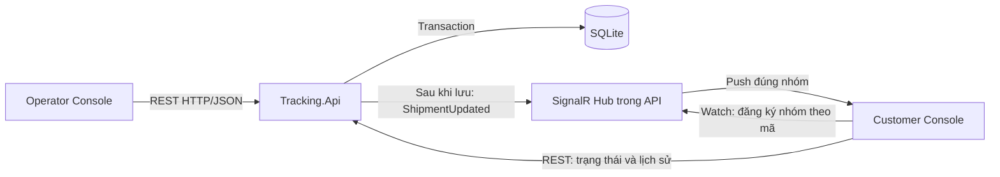

# Đề 08 — Hệ thống theo dõi bưu gửi: chapter 01–03

**Sinh viên:** Nguyễn Văn Mạnh — **MSSV:** DTC245200147.

Phiên bản thực hành đến hết **chapter 3**, học phần Phát triển ứng dụng phân tán.
C# / .NET 10 / ASP.NET Core Minimal API / SQLite / SignalR; hai client dạng Console.

## Nội dung đã hoàn thành

| Chapter | Nội dung học | Áp dụng vào đề 8 |
| --- | --- | --- |
| 01 | Client/server, request/response, Minimal API, HttpClient | API và client chạy thành các tiến trình riêng, trao đổi HTTP/JSON |
| 02 | REST, DTO, URI, HTTP status và xử lý lỗi | Tạo bưu gửi, sinh mã, cập nhật trạng thái/vị trí, tra cứu trạng thái và lịch sử |
| 03 | SignalR hub, groups, reconnect, kết hợp REST và push | Khách theo dõi một hoặc nhiều mã, nhận cập nhật ngay, đọc lịch sử khi kết nối lại |

Đây là mốc trung gian của đề 8. Kiến trúc RabbitMQ → Notification Service độc lập và đóng gói Docker của bài cuối kì sẽ được thực hiện ở các chương sau. Ở mốc chapter 3, chức năng thông báo nằm trong Tracking.Api và dùng `IHubContext` đúng nội dung bài học.

## Kiến trúc hiện tại



```text
src/
  Tracking.Contracts/  DTO, enum trạng thái, quy tắc chuyển trạng thái
  Tracking.Api/        Bốn REST endpoint, SQLite, SignalR hub
  Operator.Client/     Nhân viên tạo, cập nhật và tra cứu bưu gửi
  Customer.Client/     Khách xem lịch sử và nhận thông báo trực tiếp
tests/Tracking.Checks/ Kiểm tra tích hợp HTTP + SignalR với API thật
docs/chapters/         Hướng dẫn và giải thích cho từng chapter
requests/             HTTP mẫu để thao tác trong IDE
```

## Cài đặt và build

Cần .NET SDK 10.x; lần restore đầu cần Internet. Không cần Docker ở mốc này.
Mở PowerShell tại thư mục có `ParcelTracking.sln`:

```powershell
dotnet restore ParcelTracking.sln
dotnet build ParcelTracking.sln --no-restore
```

## Chạy và trình bày trong ba terminal

**Terminal 1 — API:**

```powershell
dotnet run --project src/Tracking.Api --no-build --urls http://localhost:5080
```

**Terminal 2 — Nhân viên tạo bưu gửi:**

```powershell
dotnet run --project src/Operator.Client --no-build -- create "Nguyễn Văn Mạnh" "Trần An" "Thái Nguyên"
```

Sao chép trường `trackingCode` trong JSON (bắt đầu bằng `BG`). Ví dụ dưới đây dùng `MA_BUU_GUI` làm chỗ điền mã thật.

**Terminal 3 — Khách bắt đầu theo dõi:**

```powershell
dotnet run --project src/Customer.Client --no-build -- MA_BUU_GUI
```

**Quay lại terminal 2 — Cập nhật hành trình:**

```powershell
dotnet run --project src/Operator.Client --no-build -- update MA_BUU_GUI InTransit "Hà Nội" "Đã xuất kho"
dotnet run --project src/Operator.Client --no-build -- update MA_BUU_GUI AtHub "Bưu cục nhận" "Đến điểm xử lý"
dotnet run --project src/Operator.Client --no-build -- update MA_BUU_GUI Delivered "Địa chỉ người nhận" "Giao thành công"
dotnet run --project src/Operator.Client --no-build -- get MA_BUU_GUI
dotnet run --project src/Operator.Client --no-build -- history MA_BUU_GUI
```

Terminal 3 nhận các dòng `[SignalR] ... InTransit/AtHub/Delivered` mà không phải gọi GET liên tục.
Để theo dõi hai mã, truyền hai đối số cho Customer.Client. Ctrl+C dừng client.
Client tự thử lại khi API chưa chạy, tự nối lại khi kết nối bị ngắt tạm thời và đăng ký lại nhóm khi kết nối mới được lập.

Có thể chạy `powershell -ExecutionPolicy Bypass -File scripts/demo.ps1` sau khi API chạy để tạo dữ liệu và hướng dẫn trình diễn từng bước.

## API và dữ liệu

| Method | Endpoint | Kết quả |
| --- | --- | --- |
| POST | `/shipments` | 201 + Location, sinh mã theo dõi |
| GET | `/shipments/{trackingCode}` | 200 + trạng thái hiện tại hoặc 404 |
| POST | `/shipments/{trackingCode}/events` | 201 + trạng thái mới; phát SignalR sau khi lưu |
| GET | `/shipments/{trackingCode}/history` | 200 + lịch sử theo version tăng dần hoặc 404 |
| GET | `/health/live`, `/health/ready` | Kiểm tra tiến trình và SQLite |
| SignalR | `/hubs/tracking` | `Watch(code)`, `Unwatch(code)`, sự kiện `ShipmentUpdated` |

Body tạo: `{"sender":"Mạnh","recipient":"An","location":"Thái Nguyên"}`.
Body cập nhật: `{"status":"InTransit","location":"Hà Nội","note":"Đã xuất kho"}`.

Các trạng thái: `Created`, `InTransit`, `AtHub`, `Delivered`, `Failed`.
Quy tắc: Created → InTransit/AtHub/Failed; InTransit → AtHub/Delivered/Failed; AtHub → InTransit/Delivered/Failed; Failed → InTransit/AtHub; Delivered là kết thúc.
Người gửi/nhận/vị trí: 1–200 ký tự; ghi chú tối đa 1000 ký tự.
400 cho dữ liệu sai, 404 cho mã không tồn tại, 409 cho chuyển trạng thái trái quy tắc.

SQLite tự tạo ở `src/Tracking.Api/data/tracking.db` khi dùng `dotnet run --project`; đường dẫn tương đối với working directory của tiến trình API. Có thể đặt `Storage__Path` bằng đường dẫn tuyệt đối.
Mỗi thao tác ghi trạng thái và lịch sử trong cùng transaction. Dữ liệu vẫn còn khi khởi động lại; thời điểm lưu UTC, client hiển thị giờ địa phương.
Header `Idempotency-Key` là bổ sung để thử lại POST mà không tạo trùng; `X-Correlation-ID` hỗ trợ đối chiếu log.

Đổi cổng/địa chỉ bằng `--urls` cho API và `$env:TRACKING_API_URL = "http://localhost:5080"` cho hai client.

## Kiểm tra tự động

```powershell
dotnet run --project tests/Tracking.Checks
```

Chương trình tự mở API ở một cổng trống, dùng database kiểm thử riêng trong `artifacts/`, kiểm tra REST, nhóm SignalR, theo dõi nhiều mã, lỗi, cập nhật đồng thời và dữ liệu sau restart, rồi dừng đúng tiến trình do nó tạo.
Các client kiểm thử dùng kết nối SignalR thật; không cần mở API thủ công trước.

## Tài liệu học và giới hạn của mốc này

- [Chapter 01: Client/server và MEP](docs/chapters/chapter01.md)
- [Chapter 02: RESTful API](docs/chapters/chapter02.md)
- [Chapter 03: SignalR](docs/chapters/chapter03.md)
- [Báo cáo tiến độ chương 1–3](docs/bao-cao-chuong01-03.md)
- [Kết quả kiểm thử: 41/41 đạt](docs/kiem-thu-chuong01-03.md)
- [Bản yêu cầu hoàn thiện giai đoạn 1 đã rà soát](docs/de-bai-giai-doan1-chapter01-03.md)

Thông báo SignalR không được lưu bền trong kết nối: nếu offline, client đọc lại lịch sử REST. Nếu hết lượt reconnect, client hướng dẫn chạy lại để đồng bộ.
Nhóm theo mã phục vụ minh họa phạm vi thông báo; phiên bản học tập chưa có xác thực/phân quyền và chỉ chạy một API instance. Không coi nhóm SignalR là cơ chế phân quyền.
Lịch sử commit ghi nhận quá trình phát triển thực tế trong phiên làm bài, không thay đổi ngày commit để giả lập các tuần học.
